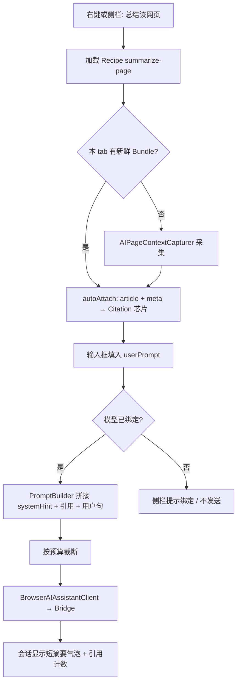

# AI 页面上下文（Page Context）— 设计方案

> 目标：让 AI 助手能把**当前标签页已解析到浏览器里的内容**（DOM / 正文 / 静态资源）拆成可单独引用的上下文；用提示词（远期 Skill）驱动「总结网页」「提取数据」「正则清洗」等场景。  
> 状态：**已确认（按推荐定稿）** · 2026-10-29  
> 开发计划：[ai-page-context-development-plan.md](ai-page-context-development-plan.md)  
> 对齐：开发计划 [ai-assistant-development-plan.md](ai-assistant-development-plan.md) **B1 整页摘要 / B2 问答本页 / Phase D**  
> 关联：[ai-assistant-design.md](ai-assistant-design.md) · [page-scraper-design.md](page-scraper-design.md) · [page-pack-design.md](page-pack-design.md) · [ai-bridge-design.md](ai-bridge-design.md) · [web-inspector-design.md](web-inspector-design.md)

---

## 0. 一句话结论

| 能力 | 结论 |
|------|------|
| 整页当上下文给 AI | **可行**。扩展现有 `AIAssistantCitation`，新增「页面快照」类引用，而不是把 HTML 糊进输入框 |
| 资源（JS/CSS/JSON/图）可单独引用 | **可行**。快照产物按 **层 + 资源条目** 拆分；芯片可单点启用/禁用 |
| 「总结该网页」= 总结正文 | **定稿**：默认动作绑 **正文层（Article）**，不是整页 HTML |
| 用户自定义提示词 | **可行**。先做 **Prompt Recipe（提示词配方）**；Skill 是同一模型的后续形态 |
| 为爬虫 / 正则 / 解析留扩展 | **定稿**：统一 **Page Context Bundle** 数据面；助手、爬虫、导出共用 |

**产品名（UI）**：页面上下文 / 「引用本页」  
**代码建议**：`SimpleBrowser/AIAssistant/PageContext/`，类型前缀 `AIPageContext*`；Citation 扩展 kinds  
**产品路径**：PC-0 正文摘要 → PC-1 可引用 Bundle → PC-2 资源库与配方 → PC-3 Skill / 与爬虫合流

---

## 1. 需求理解

| # | 原始设想 | 理解与定稿 |
|---|---------|------------|
| 1 | 已解析进浏览器的实际 HTML + 相关静态资源（json/js/css/图片）都可作为上下文，且可单独引用 | 一次采集生成 **Page Context Bundle**；对外暴露为多条 Citation；用户勾选哪些进 prompt |
| 2 | 自定义提示词；通用「总结该网页」实际总结正文 | **Recipe**：显示名短、系统指令长；默认 Recipe 只注入 `article`（或 `visibleText`） |
| 3 | 上下文可引用，便于爬虫、正则、解析等延伸 | Bundle 是一等公民数据；助手只是消费方之一；日后 Scraper / 导出 / 脚本可同读 |

以上理解正确。关键纠偏见 §2。

---

## 2. 相对原始设想的优化（强烈建议采纳）

| # | 原始点 | 风险 | 更优做法 |
|---|--------|------|----------|
| U1 | 「整页 HTML + 全部资源」默认塞进一次对话 | Bridge 网页模型上下文窗极窄；几 MB 必失败；隐私面过大 | **分层默认 + 显式勾选**。默认只带 Meta + Article；HTML/资源进「资源盘」，用户点芯片或 `@` 才注入 |
| U2 | 把「总结」做成特殊硬编码功能 | 与划词总结、自定义场景分裂 | 统一成 **Recipe × Citations**；「总结该网页」只是一条内置 Recipe |
| U3 | 图片一律当文本 URL 塞 prompt | 多数 Bridge Provider 无真多模态 | 图片默认：URL + alt + 尺寸；有缩略图时侧栏预览；真识图走多模态 Provider（已有图片 Citation 雏形） |
| U4 | 每次发消息现抓 DOM | SPA 变化、与用户所见不一致、主线程卡顿 | **显式「采集本页」或动作触发时快照**；Bundle 带 `capturedAt`；芯片显示「当前页 · 3 分钟前」 |
| U5 | 与爬虫、PagePack 各造一套抽取 | 重复 JS、选择器漂移 | **共享页内抽取契约** `window.__MeoPageContext`；Scraper 字段抽取可复用同一 runtime |
| U6 | 立刻做 Skill 系统 | 无沙箱、无版本、UI 未稳 | **先 Prompt Recipe（JSON）**；字段预留 `inputs` / `requiredLayers`，日后升格 Skill 不改交互 |

---

## 3. 方案定位

### 3.1 产品一句话

**把当前标签页拍成可勾选的「上下文零件」**——默认零件是正文，需要时再挂上 HTML、脚本、样式、JSON 与图片；用短提示词或配方驱动 AI，而不是每次手搓整页粘贴。

### 3.2 与现有能力的关系

| 能力 | 现状 | 本方案 |
|------|------|--------|
| `AIAssistantCitation` | text / url / image / file / link + 芯片条 | **扩展 kinds**；页面层与资源条目都变成 Citation |
| 划词右键 AI / 「加入引用」 | 选区与图片引用已通 | 无选区时强化 **页面级** 菜单；保留加入引用 |
| `BrowserAIAssistantPrompts` | ask/explain/summarize/translate；pageContext 仅标题+URL | 升级为 **Recipe 表**；B1 真正吃正文 |
| AI Bridge | 文本为主的 completions | 组装后的 prompt 仍走现有 Client；超长时本地裁剪并提示 |
| 页面爬虫 | Recipe + 点选字段 | Bundle 的 `structured` / DOM 可供「用本页 Bundle 预填 Scraper」 |
| 查看源代码 | DOM 快照新标签 | 采集器可复用同源 evaluate；不替代 Inspector |
| 阅读模式（路线图） | 未做 | Article 层算法可与阅读模式共用（Readability 类） |

### 3.3 做什么 / 不做什么

| 阶段 | 做 | 不做 |
|------|----|------|
| **PC-0** | 采集 Meta + Article；「总结本页」Recipe；侧栏一键；右键无选区「总结本页」 | 全资源包、自定义 Recipe UI |
| **PC-1** | Bundle 落盘/内存；层级 Citation 芯片；`@本页` / 资源盘勾选；HTML 层可选 | 拦截全部网络 HAR、打包 WebArchive 完整离线站 |
| **PC-2** | 资源索引（script/link/img/json）；单资源引用；用户 Recipe CRUD；斜杠命令 | 远程 Skill 商店 |
| **PC-3** | Skill 运行时（Recipe + 可选本地 JS 预处理）；与 Scraper「从 Bundle 提取」；`meobrowser://ai?action=…` | 云端爬取、绕过站点登录墙 |

### 3.4 设计原则

1. **所见即所采**：以当前 `WKWebView` 已渲染 DOM 为准（含用户滚动后的可见区选项），不另起无头请求重下。  
2. **零件化**：上下文永远是 Citation 列表，不是一坨隐藏 system prompt。  
3. **默认最小够用**：总结 / 问答默认 Article；开发向动作才要 HTML/JS。  
4. **显式采集、可过期**：导航或超时后芯片标黄「可能过期」，一键重采。  
5. **隐私默认本地**：Bundle 默认会话级；不落盘全文除非用户「固定到会话」或导出。  
6. **为专业用户留刀**：正则、选择器、原始 HTML 都在资源盘里，不挡在日常总结路径上。

---

## 4. 核心概念：Page Context Bundle

一次采集产生一个 Bundle（逻辑包），再投影为多条 Citation。

```text
AIPageContextBundle
├── id, tabId, url, title, capturedAt, contentHash
├── layers[]          ← 逻辑层（可整层引用）
│   ├── meta          标题 / URL / 描述 / 语言 / canonical
│   ├── article       正文纯文本（Readability 类）★ 默认总结用
│   ├── visibleText   当前视口可见文本（可选）
│   ├── markdown      简化 MD（标题层级 + 链接）
│   ├── html          清理后的 documentElement.outerHTML（截断策略见 §7）
│   ├── outline       h1–h3 提纲
│   ├── links         页内 a[href] 列表
│   ├── selection     当前选区（若有）
│   └── structured    启发式表格/JSON-LD（可选）
└── resources[]       ← 单资源条目（可单独引用）
    ├── kind: script | stylesheet | json | image | font | other
    ├── url, mime, size, inline?
    ├── textPreview / textFull（文本类；有大小上限）
    └── thumb（图片；复用现有 previewImage）
```

### 4.1 资源从哪来（务实分级）

| 级 | 来源 | 阶段 | 说明 |
|----|------|------|------|
| **L1 DOM 清单** | `document.scripts` / `link[rel=stylesheet]` / `img` / `application/ld+json` / `script[type=application/json]` | PC-0/1 | 不保证拿到**响应体**；至少有 URL + 内联正文 |
| **L2 内联全文** | 内联 `<script>` / `<style>` / JSON-LD 直接读 `textContent` | PC-1 | 已在文档里，零网络 |
| **L3 同源再取** | 对同 origin 的 src/href `fetch`（页内 JS）或 Native 带 Cookie 请求 | PC-2 | 用户手点「加载正文」才拉，防爆 |
| **L4 网络旁路** | 导航期记录的响应缓存（轻量 resource log） | PC-3 可选 | 接近「浏览器里实际用过的静态数据」；实现成本高，不做默认 |

**定稿叙事**：产品文案写「当前页已加载的 DOM 与可解析资源」，不承诺完整 HAR/WebArchive。对用户心智足够；工程可迭代加深。

### 4.2 Citation Kind 扩展（建议）

在现有 enum 上追加（或用 `AIAssistantCitationKindPage*` 分组）：

| Kind | 芯片示意 | `promptBlock` 要点 |
|------|----------|-------------------|
| `pageMeta` | 页 · example.com | 标题/URL/description |
| `pageArticle` | 正文 · 约 2.4k 字 | 纯文本正文 |
| `pageHTML` | HTML · 186 KB | fenced code；声明已截断 |
| `pageOutline` | 提纲 | 标题树 |
| `pageMarkdown` | MD · 本页 | 简化 markdown |
| `resourceScript` | JS · app.js | URL + 正文或「仅 URL」 |
| `resourceStyle` | CSS · main.css | 同上 |
| `resourceJSON` | JSON · config | pretty print 截断 |
| `resourceImage` | 复用现有 image | URL + alt + 可选缩略图 |
| （保留）text/url/file/link | 划词与外链 | 不变 |

发送时仍走现有逻辑：芯片 → `promptBlock` 拼接 → Bridge。**显示给用户的气泡**继续用「📎 N 条引用 · 总结该网页」，避免把 50KB HTML 刷在会话里。

---

## 5. Prompt Recipe（提示词配方）— Skill 的前身

### 5.1 模型

```json
{
  "id": "summarize-page",
  "title": "总结该网页",
  "symbol": "doc.text",
  "description": "提炼正文要点，忽略导航与广告",
  "userPrompt": "请总结该网页的正文要点，用简洁中文分条列出；不要复述导航、页脚或广告。",
  "systemHint": "你只会看到用户勾选的引用。若有「正文」层，请主要依据正文；不要臆造未出现的信息。",
  "requiredLayers": ["article"],
  "optionalLayers": ["meta", "outline"],
  "autoAttach": ["article", "meta"],
  "captureIfMissing": true,
  "maxArticleChars": 24000,
  "outputFormat": "bullets"
}
```

| 字段 | 作用 |
|------|------|
| `title` | 侧栏快捷按钮 / 右键菜单显示名 |
| `userPrompt` | 填入输入框、可编辑的那句「人类话」 |
| `systemHint` | 拼在引用区之前的固定约束（可折叠进发送包，侧栏可不展示全文） |
| `autoAttach` | 执行时自动勾选并采集的层 |
| `requiredLayers` | 缺层则先采集；失败则提示 |
| `captureIfMissing` | 无新鲜 Bundle 时自动采 |

用户自定义 Recipe：复制内置 → 改 `userPrompt` / `autoAttach` → 存  
`~/Library/Application Support/MeoBrowser/AIAssistant/Recipes/*.json`。

### 5.2 内置 Recipe 建议（PC-0～PC-2）

| id | 显示名 | autoAttach | 典型用途 |
|----|--------|------------|----------|
| `summarize-page` | 总结该网页 | article + meta | **默认整页动作** |
| `ask-page` | 问答本页 | article + meta | B2 |
| `outline-page` | 生成提纲 | outline + article | 长文 |
| `explain-jargon` | 名词解释 | article（可先划词优先） | 与划词解释合并策略 |
| `extract-facts` | 提取要点/数据 | article + structured | 半结构化 |
| `regex-extract` | 按正则提取 | html 或 article | 高级；提示词里让用户贴正则 |
| `css-select` | 按选择器说明抽取 | html | 「用 CSS 选择器描述你要的节点，我帮你写出抽取逻辑」 |
| `to-scraper-hint` | 帮我设计爬虫字段 | html + structured | 输出字段名/选择器建议，可一键跳转爬虫侧栏 |
| `diff-resources` | 分析页内 JSON/配置 | resourceJSON | API 文档页、配置页 |
| `a11y-skim` | 无障碍/结构快检 | outline + html（截断） | 专业向彩蛋 |

划词动作（已有）保持独立短 Recipe：`summarize-selection` 等；`autoAttach` = 当前 text Citation。

### 5.3 从 Recipe 到 Skill（预留，不实现）

Skill = Recipe + 可选 `preprocess`（页内 JS 或本地脚本，输入 Bundle，输出新 Citation）+ `postprocess`。  
UI 仍是「选 Skill → 自动采/挂引用 → 可改提示 → 发送」。PC-3 再开，避免过早造运行时。

---

## 6. 交互与 UI

### 6.1 信息架构（助手侧栏内，不新开互斥侧栏）

窄侧栏已有：顶栏会话 / 模型 · 中部对话 · 底部引用芯片 + 输入。页面上下文嵌在**底部引用区上方**，避免再占一个 trailing kind。

```text
┌─ AI 助手 ─────────────── ✕ ─┐
│ ⟨历史  本会话标题  ＋ ⟩       │
│ 模型 ● DeepSeek …            │
├──────────────────────────────┤
│  （对话气泡）                 │
├──────────────────────────────┤
│ 本页上下文 · 3 分钟前  [重采] │  ← 折叠条；点开 = 资源盘
│ [总结该网页][问答][…][配方▾]  │  ← 快捷 Recipe 横滑
│ 📎 正文  📎 页信息  ✕ …      │  ← 已挂 Citation 芯片（可关）
│ ┌ 输入框（SBTextView）──────┐ │
│ │ 总结该网页                 │ │
│ │ 也可 @正文 或 /总结        │ │
│ └────────────────────────────┘ │
│              [发送]            │
└──────────────────────────────┘
```

**资源盘（展开「本页上下文」）**：

```text
┌ 本页 · docs.example.com/api ────────┐
│ 采集于 12:01 · DOM 就绪 · [重新采集] │
│ 层                                   │
│ ☑ 页信息   ☑ 正文(2.4k)  ☐ HTML     │
│ ☐ 提纲     ☐ Markdown   ☐ 链接列表  │
│ 资源  筛选 [全部▾] [文本已加载]      │
│ ☐ JS  app.js        120 KB  [加载]  │
│ ☐ CSS main.css       44 KB  [加载]  │
│ ☑ JSON ld+json        3 KB          │
│ ☐ 图  hero.png       —     [缩略]   │
│ [全选默认层] [仅正文] [导出 Bundle]  │
└─────────────────────────────────────┘
```

勾选 = 加入/移除 Citation 芯片；与现有「加入引用」同一套数据。

### 6.2 输入增强（专业感、成本可控）

| 交互 | 行为 |
|------|------|
| **快捷 Recipe 按钮** | 一键：`captureIfMissing` → `autoAttach` → 填入 `userPrompt` → 若模型已绑定可自动发送（对齐划词） |
| **`/` 斜杠** | `/总结` `/问答` `/正则` 弹出 Recipe 列表（键盘友好，对标命令面板） |
| **`@` 提及** | `@正文` `@HTML` `@app.js` 从当前 Bundle 挂引用；无 Bundle 先采 |
| **拖拽** | 从资源盘行拖到芯片区（PC-2） |
| **芯片** | 单击预览（popover：字数、截断说明、前 20 行）；✕ 移除；右键「固定到会话 / 复制 / 另存」 |

### 6.3 右键菜单（最佳落点）

在现有「AI」「加入引用」旁扩展，按命中目标分流：

**A. 有选区（保持并加强）**

- AI → 问问 / 解释 / 总结 / 翻译（现有）  
- 加入引用（现有）  
- （新）加入引用并提问… → 开侧栏，芯片已挂，焦点在输入框

**B. 无选区 · 页面空白/通用**

- **总结该网页**（默认 Recipe，自动采 Article）  
- **问答本页…**（开侧栏，挂正文，不自动发送）  
- **引用本页 ▸**  
  - 页信息 / 正文 / 提纲 / HTML（谨慎） / 重新采集并引用  
- 加入当前页链接为引用（现有 URL Citation）

**C. 命中图片 / 链接 / 文件**

- 保持现有图片/链接引用  
- （新）**同时引用所在页正文**（可选修饰键或子项）——解决「图是什么意思」需正文语境

**D. 命中 `<script>` / 查看资源类（进阶，PC-2）**

- 引用此脚本 / 引用此 JSON 块  

菜单文案短；危险项（整页 HTML）放子菜单，避免误触把巨石送进模型。

### 6.4 其它入口

| 入口 | 行为 |
|------|------|
| Chrome / 工具菜单 | 现有「AI 助手」；侧栏内快捷按钮即可 |
| 命令面板（若落地） | `总结当前页` `采集页面上下文` `打开页面资源盘` |
| URL Scheme（Phase D） | `meobrowser://ai?action=summarize` → 当前 tab 跑 `summarize-page` |
| 页面爬虫侧栏 | 「从 AI 正文/HTML 导入建议字段」（PC-3） |

### 6.5 UI 细节原则（贴合本 App）

- 输入一律 **SBKit**（已有）。  
- 侧栏宽度已 280～560；资源盘用**折叠 + 内部滚动**，不要再开第四个互斥侧栏。  
- 快捷 Recipe 用小按钮横滑，避免 pill 堆砌；默认只钉 3 个：总结 / 问答 / 更多▾。  
- 过期 Bundle：状态条橙色「页面已导航，上下文可能过期」+ 一键重采。  
- 超长裁剪：发送前 toast「正文已截断至 24k 字；完整内容在资源盘」。

---

## 7. 采集管道与裁剪

### 7.1 页内契约（建议）

`window.__MeoPageContext.capture(options) → BundleJSON`（经 `evaluateJavaScript`）

```js
{
  capture(opts) {
    // opts.layers: ['meta','article','html',...]
    // opts.includeResourceIndex: true
    // opts.maxHtmlChars, maxArticleChars
  }
}
```

Article 算法优先级：

1. 简明 Readability 移植 / 去噪（导航、footer、aside）  
2. 失败则 `main` / `article` / `[role=main]`  
3. 再失败则 `body` 可见文本 + 警告 flag `articleQuality=low`

HTML 层：序列化前可剥 `svg` 路径噪声、过长 base64 `src`、hidden 节点（可配置）。

### 7.2 Native 职责

| 模块 | 职责 |
|------|------|
| `AIPageContextCapturer` | 调 JS、超时、主线程外写临时文件 |
| `AIPageContextStore` | 按 tabId 持有最新 Bundle；导航时标记 stale |
| `AIPageContextPromptBuilder` | Recipe + 勾选 Citation → 最终 API 字符串；统一截断 |
| `BrowserAIAssistantPrompts` | 改为读 Recipe 表（内置 + 用户） |

### 7.3 预算（默认，可设置）

| 层 | 默认上限 | 超出 |
|----|----------|------|
| article | 24 000 字 | 头尾保留 + 中部省略标记 |
| html | 100 000 字 | 同左；芯片标「已截断」 |
| 单 resource 文本 | 64 KB | 「加载」时再拉并截断 |
| 单次 prompt 总计 | 32 000 字（可按 Provider 配置） | 发送前强制裁 + 列出丢弃层 |

网页 Bridge 模型更脆：可按 `modelId` 设更小预算（如 12k）。

---

## 8. 创意增强（差异化 Idea）

下列不阻塞 MVP，但很适合 Meo「专业浏览器」定位，建议写进路线图彩蛋位。

1. **上下文时间旅行**  
   同一 tab 保留最近 3 次 Bundle，对话里可「对比上一版正文」——适合文档站改版、热更新页。

2. **「只看我选的 DOM」**  
   复用爬虫 `ElementPicker`：点选一块区域 → 生成 `selection`/`subtreeHTML` Citation。比整页 HTML 准一个数量级。

3. **Regex Lab 内嵌**  
   Recipe `regex-extract` 打开时，侧栏小面板：正则 + 目标层（article/html）+ **本地预览匹配**（不经过 AI）→ 满意再「请 AI 解释/清洗结果」。省 token、可验真。

4. **JSON 路径助手**  
   挂上 `resourceJSON` 后，输入 `@$.data.items[*].name` 这类路径，本地先 jq 式抽取，再把**抽取结果**当 Citation 发给 AI。

5. **一键「变成爬虫配方」**  
   AI 返回字段表 → 「应用到页面爬虫」写入 `BrowserScraperRecipe` 草稿。打通 B1 与 Scraper，而不是两套话术。

6. **阅读模式双开**  
   开阅读模式时，Article 层与阅读视图同源；侧栏总结与「眼前所见」一致。

7. **隐私档位**  
   会话级开关：`严格`（禁止 html/script 出站）、`标准`（默认）、`开发`（允许资源全文）。绑 Bridge 云网页时默认升到「标准」并提示。

8. **@剪贴板 / @下载文件**  
   与页面 Bundle 同一芯片体系，方便「网页说明 + 本地 CSV」混问（仍是 Citation，零新概念）。

9. **失败可解释**  
   Article 质量低时，快捷按钮旁提示「正文提取较弱，改用可见文本或手动点选区域」。

10. **Prompt 市集本地化**  
    用户导出/导入 Recipe JSON（单文件），团队共享「总结 RFC」「从 Changelog 提 breaking changes」等，无需 Skill 运行时。

---

## 9. 端到端流程（默认「总结该网页」）



---

## 10. 隐私与安全

1. Bundle 默认内存；退出会话可清。用户「固定引用」才写入 Session Store。  
2. 日志与 Bridge SessionLog **不写** HTML/正文全文（延续 Bridge 脱敏）。  
3. `file://`、内网、带 token 的 query：采集 HTML 前可剥 query 或提示。  
4. 自动加载跨域资源：**默认关闭**；仅 L1 索引 + 内联。  
5. 合规文案：总结的是用户已打开页面的本地快照；请遵守站点条款与版权。

---

## 11. 分阶段验收

### PC-0（对应计划 B1）

- [ ] 右键无选区「总结该网页」→ 开助手 → 采正文 → 自动发送（已绑定）  
- [ ] 侧栏快捷「总结该网页」同上  
- [ ] 用户气泡不展示全文，仅「📎 2 条引用 · 总结该网页」  
- [ ] Article 失败时有可读降级与提示  
- [ ] 输入框提示词可改后再发  

### PC-1

- [ ] 资源盘可勾选 meta/article/html/outline  
- [ ] 芯片可删；重采刷新  
- [ ] 导航后 stale 提示  
- [ ] 超长截断有状态反馈  

### PC-2

- [ ] 资源索引 + 单资源引用  
- [ ] 用户自定义 Recipe；`/` 与 `@`  
- [ ] 内置 `regex-extract` / `ask-page`  

### PC-3

- [x] Skill 预处理挂钩  
- [x] 导出 Bundle / 应用到 Scraper  
- [x] `meobrowser://ai?action=summarize`  

---

## 12. 文档与代码落点

| 路径 | 说明 |
|------|------|
| `docs/minimal-browser/ai-page-context-design.md` | 本文 |
| `docs/minimal-browser/ai-assistant-development-plan.md` | B1/B2 勾选对齐本方案 PC-0/1 |
| `docs/minimal-browser/ai-assistant-design.md` | §6 后续能力改为链到本文 |
| `SimpleBrowser/AIAssistant/PageContext/` | Capturer / Store / PromptBuilder |
| `SimpleBrowser/AIAssistant/AIAssistantCitation.*` | 扩展 kind + promptBlock |
| `SimpleBrowser/AIAssistant/Recipes/` | 内置 JSON |
| `Application Support/.../AIAssistant/Recipes/` | 用户 Recipe |

---

## 13. 决策清单（已确认 · 2026-10-29）

| # | 问题 | 定稿 |
|---|------|------|
| D1 | 默认总结用 Article 还是 VisibleText？ | **Article**；质量低再降级 VisibleText / 点选区域 |
| D2 | HTML/全资源是否允许一键「全部引用」？ | **允许**，须二次确认 + 预算裁剪 |
| D3 | Bundle 是否默认落盘？ | **否**；仅会话内存 + 可选固定到会话 |
| D4 | 资源体获取深度 | PC-2 做 **L3 按需**；L4 网络旁路观望 |
| D5 | 自定义提示词 UI 形态？ | 「更多▾ → 管理配方」列表；不做沉重编辑器 |
| D6 | 是否单独 trailing 侧栏？ | **否**；嵌助手底部资源盘 |

实施见 [ai-page-context-development-plan.md](ai-page-context-development-plan.md)，自 **PC-0** 起。
